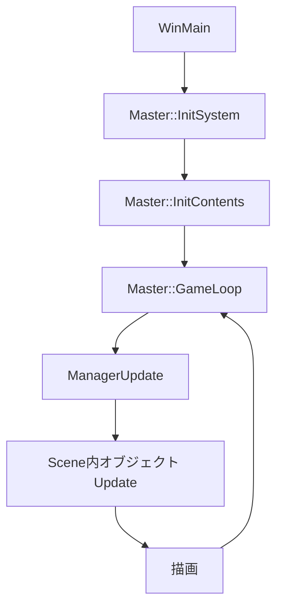

# (エンジン名)

<!--
  【書き方】
  エンジンの正式名 or 愛称を入れる。
  直下に「一言で何のエンジンか」を1行で書くと分かりやすい。
  例: DxLibベースの2Dゲームエンジン
-->

> (一言説明)

---

## 概要

<!--
  【書くこと】
  - 何を作るためのエンジンか(2Dアクション / シューティング / 授業課題用 など)
  - 作った動機・目的
  - 特徴を3〜5個ほど箇条書き(例: シーン管理、レイヤーによる当たり判定制御、複数カメラ、ビットマップフォント対応)
  - 他のエンジン/ライブラリとの違い(あれば)
  2〜5行くらいでOK。
-->

## 動作環境

<!--
  【書くこと】
  - OS: Windows(WinMain / windows.h を使用しているため)
  - 言語・規格: C++ (C++14? 17? ← 実際の設定を記入)
  - IDE / コンパイラ: Visual Studio 20XX など
  - 依存ライブラリ: DxLib (バージョンがあれば記入)
-->

| 項目 | 内容 |
| --- | --- |
| OS | Windows |
| 言語 | C++ (   ) |
| IDE | (   ) |
| 依存ライブラリ | DxLib (   ) |

## セットアップ

<!--
  【書くこと】
  1. DxLib の入手先と配置場所(インクルードパス / ライブラリパスの設定方法)
  2. プロジェクトの開き方・ビルド手順
  3. 実行して最初に何が表示されれば成功か(例: 「SAMPLE SCENE」と画像が2画面に表示される)
  つまずきやすい点があれば注意書きとして追記。
-->

1. (手順1)
2. (手順2)
3. (手順3)

## フォルダ構成

<!--
  【書くこと】
  各フォルダ/ファイルが何をするかを1行で。
  下は現在の構成からの下書きなので、実際の役割に合わせて直してください。
  「エンジン側(触らない)」と「ゲーム側(ユーザーが書く)」の区別を明記すると親切。
-->

```
.
├─ engine/                    … エンジン本体(基本的に触らない)
│  ├─ Main.cpp                … エントリポイント(WinMain)
│  ├─ BaseObj.h               … 全オブジェクトの基底クラス
│  ├─ Master/                 … 全体統括(シングルトン)
│  │  └─ Manager/             … 各種マネージャー
│  │     ├─ SceneManager      … シーンの登録・切り替え
│  │     ├─ InputManager      … キーボード / マウス入力
│  │     ├─ TimeManager       … DeltaTime など時間管理
│  │     ├─ WindowManager     … ウィンドウ / フルスクリーン
│  │     ├─ LayerManager      … レイヤー間の当たり判定設定
│  │     ├─ FontsManager      … ビットマップフォント管理
│  │     ├─ ImageManager      … 画像 / スプライト管理
│  │     └─ EnableConsole     … デバッグ用コンソール(Debugのみ)
│  ├─ EngineObject/           … 標準で用意されたオブジェクト
│  │  ├─ Camera               … カメラ
│  │  ├─ Text                 … 文字表示
│  │  └─ ImageObj             … 画像表示
│  ├─ Structs/                … Vector2/3, Rect, Color, Sprite など基本構造体
│  └─ Utils/                  … Math, Collision, Render, Anchor, Tag など
├─ Objects/                   … ユーザー定義オブジェクト(例: TextMove)
├─ Options/                   … 設定ファイル群(ウィンドウ / フォント / 画像 / レイヤー)
├─ Types/                     … TagType.h / LayerType.h(タグ・レイヤーの定義)
├─ AddScene.h / .cpp          … シーンの追加場所
└─ Images/                    … 使用する画像素材
```

## 全体の仕組み(アーキテクチャ)

<!--
  【書くこと】
  エンジンがどう動くかの全体像。
  - 起動の流れ: WinMain → InitSystem → InitContents → GameLoop
  - Master(シングルトン)が各Managerを保持し、Master::Input() のように外部から取得できること
  - 1フレームの流れ(入力更新 → Update → 衝突判定 → 描画 など。実際の順序を記入)
  - 可能なら図(mermaid等)を入れると◎
-->



<!-- ↑ 実際のループ内容に合わせて修正 -->

## 基本の使い方

### 1. シーンを作る

<!--
  【書くこと】
  - Scene を継承したクラスの作り方(ObjSet() をオーバーライドする)
  - AddScene.cpp の SceneManager::AddScene() で SceneSet<クラス名>() を呼んで登録する流れ
  - 最初に表示されるシーンはどれか / シーン切り替え方法
  最小のコード例を載せる。
-->

```cpp
// (例) シーンの定義と登録
```

### 2. オブジェクトを置く

<!--
  【書くこと】
  - CreateObj<型>(引数...) でシーンにオブジェクトを追加する方法
  - Camera / Text / ImageObj の引数の意味(座標・サイズ・色など)
  - アンカー(Anchor)の指定方法と、各位置の意味
-->

```cpp
// (例) Camera, Text, ImageObj を配置するコード
```

### 3. オブジェクトを自作する

<!--
  【書くこと】
  - BaseObj / 既存クラス(Text など)を継承して作る手順
  - オーバーライドできる関数(Start / Update / Draw など)と呼ばれるタイミング
  - Objects/Objects.h に書く想定かどうか
  例: TextMove(WASDで動くテキスト)を題材にすると分かりやすい。
-->

```cpp
// (例) Update をオーバーライドして WASD で動かす
```

### 4. 入力を取る

<!--
  【書くこと】
  - Master::Input().KeyBoard() / Mouse() の使い方
  - IsHeld / IsPressed / IsReleased など関数の種類と違い(実際の関数名で)
  - キーコード(KeyBoardCode)の一覧がある場所
-->

### 5. 時間(DeltaTime)

<!--
  【書くこと】
  Master::Time().DeltaTime() の使い方。
  移動量に掛ける理由(フレームレート非依存)を一言。
-->

### 6. 画像・フォントを使う

<!--
  【書くこと】
  - 画像の登録方法(Options/ImageOption.cpp に何をどう書くか)
  - スプライトシートの扱い(SearchSprite("名前").GetImage(x, y) の意味)
  - ビットマップフォントの登録方法(Options/FontsOption.cpp)と Text での指定方法
  - 読み込み失敗時に error.png が表示される仕様(あれば)
-->

## 機能リファレンス

### Camera

<!--
  【書くこと】
  コンストラクタ引数の意味(ワールド座標 / 画面上の位置とサイズ / 背景色)、
  複数カメラの使い方(サンプルでは2画面分割)、WorldCameraSide() などの便利関数。
-->

### レイヤー / タグ

<!--
  【書くこと】
  - Types/LayerType.h, TagType.h への追加方法
  - レイヤーの役割(当たり判定の対象制御)
  - Options/LayerOption.cpp の RemoveCollide(A, B) で「当たらない組み合わせ」を指定する方法
  - タグの使いどころ(オブジェクト検索など。ObjectFinder があれば併記)
-->

### 当たり判定(Collision)

<!--
  【書くこと】
  対応している形状(矩形 / 円 など)、判定関数の呼び方、
  HitSide(どの面に当たったか)の使い方、戻り値の意味。
-->

### アンカー(Anchor)

<!--
  【書くこと】
  Anchor::Type の一覧と、それぞれが基準にする位置(中央 / 左上 / 下中央 など)。
  図やASCIIアートで示すと分かりやすい。
-->

### 数学 / 構造体 (Math, Vector2/3, Rect, Color, Side)

<!--
  【書くこと】
  よく使うものだけでOK。
  Vector2<float> の演算子、Cast<T>()、Color の指定形式(0xRRGGBB?)など。
-->

### ウィンドウ設定

<!--
  【書くこと】
  Options/WindowOptions.cpp で変えられる項目(サイズ、タイトル、フルスクリーン等)。
  フルスクリーン切り替えのキーがあれば記載。
-->

### デバッグ機能

<!--
  【書くこと】
  Debugビルド時のみ有効なコンソール(EnableConsole)の使い方、
  ログ出力の方法など。
-->

## サンプル

<!--
  【書くこと】
  AddScene.cpp の SampleScene で何が起きるか。
  スクリーンショット or GIF を貼る: 
-->

## 既知の制限 / 今後の予定 (TODO)

<!--
  【書くこと】
  未実装の機能、既知のバグ、やりたいこと(音声再生、アニメーション、物理など)。
  正直に書いた方が後から自分が助かる。
-->

- [ ] (例) 音声管理マネージャーの追加
- [ ] (例) アニメーション機能

## 使用素材・クレジット

<!--
  【書くこと】
  Images/ にある素材の出典とライセンス。
  - kenney の素材(kenney.nl / CC0)など、実際に使っているものを列挙
  - Pikachu / PixelGhost の画像は権利的に配布時に問題ないか確認(公開する場合は差し替えを推奨)
  - DxLib のライセンス表記(配布する場合)
-->

## ライセンス

<!--
  【書くこと】
  MIT / 個人利用のみ / 未定 など。公開しないなら「非公開」でOK。
-->

## 作者

<!--
  名前 / 連絡先 / GitHub など。
-->
