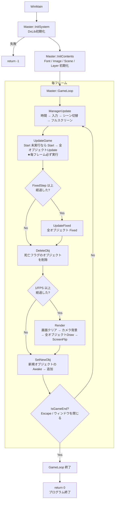

# 自作エンジン

<!--
  【書き方】
  エンジンの正式名 or 愛称を入れる。
  直下に「一言で何のエンジンか」を1行で書くと分かりやすい。
  例: DxLibベースの2Dゲームエンジン
-->

> DxLibベースの2Dゲームエンジンです。
> 私が一人で2025年からずっと作り続けてきたエンジンとなっています。

---

## 概要

<!--
  【書くこと】
  - 何を作るためのエンジンか(2Dアクション / シューティング / 授業課題用 など)
  - 作った動機・目的
  - 特徴を3〜5個ほど箇条書き(例: シーン管理、レイヤーによる当たり判定制御、複数カメラ、ビットマップフォント対応)
  - 他のエンジン/ライブラリとの違い(あれば)
  2〜5行くらいでOK。
-->

このエンジンは、いろいろな2Dゲームを作成できることを目標に作成してきたエンジンとなっています。
作った動機としては、Unityの関数の中身やどのように作られているかを理解したいと思い、自分のその時学習意欲がとても高かったC++で作成し始めました。
エンジンファイルの中身は触らなくともゲームを作れるように作成。
複数のカメラを置くことができるようにしている。
基本オブジェクトを引けば、勝手に更新されるように。

## 動作環境

<!--
  【書くこと】
  - OS: Windows(WinMain / windows.h を使用しているため)
  - 言語・規格: C++ (C++14? 17? ← 実際の設定を記入)
  - IDE / コンパイラ: Visual Studio 20XX など
  - 依存ライブラリ: DxLib (バージョンがあれば記入)
-->

| 項目           | 内容           |
| -------------- | -------------- |
| OS             | Windows        |
| 言語           | ISO C++17 標準 |
| IDE            | Visual Studio  |
| 依存ライブラリ | DxLib          |

## セットアップ

<!--
  【書くこと】
  1. DxLib の入手先と配置場所(インクルードパス / ライブラリパスの設定方法)
  2. プロジェクトの開き方・ビルド手順
  3. 実行して最初に何が表示されれば成功か(例: 「SAMPLE SCENE」と画像が2画面に表示される)
  つまずきやすい点があれば注意書きとして追記。
-->

1. (手順1)
2. (手順2)
3. (手順3)

## フォルダ構成

<!--
  【書くこと】
  各フォルダ/ファイルが何をするかを1行で。
  下は現在の構成からの下書きなので、実際の役割に合わせて直してください。
  「エンジン側(触らない)」と「ゲーム側(ユーザーが書く)」の区別を明記すると親切。
-->

```
.
├─ engine/                    … エンジン本体(基本的に触らない)
│  ├─ Main.cpp                … エントリポイント(WinMain)
│  ├─ BaseObj.h               … 全オブジェクトの基底クラス
│  ├─ Master/                 … 全体統括(シングルトン)
│  │  └─ Manager/             … 各種マネージャー
│  │     ├─ SceneManager      … シーンの登録・切り替え
│  │     ├─ InputManager      … キーボード / マウス入力
│  │     ├─ TimeManager       … DeltaTime など時間管理
│  │     ├─ WindowManager     … ウィンドウ / フルスクリーン
│  │     ├─ LayerManager      … レイヤー間の当たり判定設定
│  │     ├─ FontsManager      … ビットマップフォント管理
│  │     ├─ ImageManager      … 画像 / スプライト管理
│  │     └─ EnableConsole     … デバッグ用コンソール(Debugのみ)
│  ├─ EngineObject/           … 標準で用意されたオブジェクト
│  │  ├─ Camera               … カメラ
│  │  ├─ Text                 … 文字表示
│  │  └─ ImageObj             … 画像表示
│  ├─ Structs/                … Vector2/3, Rect, Color, Sprite など基本構造体
│  └─ Utils/                  … Math, Collision, Render, Anchor, Tag など
├─ Objects/                   … ユーザー定義オブジェクト(例: TextMove)
├─ Options/                   … 設定ファイル群(ウィンドウ / フォント / 画像 / レイヤー)
├─ Types/                     … TagType.h / LayerType.h(タグ・レイヤーの定義)
├─ AddScene.h / .cpp          … シーンの追加場所
└─ Images/                    … 使用する画像素材
```

## 全体の仕組み(アーキテクチャ)

<!--
  【書くこと】
  エンジンがどう動くかの全体像。
  - 起動の流れ: WinMain → InitSystem → InitContents → GameLoop
  - Master(シングルトン)が各Managerを保持し、Master::Input() のように外部から取得できること
  - 1フレームの流れ(入力更新 → Update → 衝突判定 → 描画 など。実際の順序を記入)
  - 可能なら図(mermaid等)を入れると◎
-->



<!-- ↑ 実際のループ内容に合わせて修正 -->

## 基本の使い方

### 1. シーンを作る

<!--
  【書くこと】
  - Scene を継承したクラスの作り方(ObjSet() をオーバーライドする)
  - AddScene.cpp の SceneManager::AddScene() で SceneSet<クラス名>() を呼んで登録する流れ
  - 最初に表示されるシーンはどれか / シーン切り替え方法
  最小のコード例を載せる。
-->

```cpp

// AddScene.h
// Sceneクラスを引き継いだオブジェクトを作成し、ObjSet()をオーバーライドする。
class SampleScene : public Scene {
	void ObjSet() override;
};

// AddScene.cpp
// cppファイルにオブジェクトを設定する関数を設定する
void SampleScene::ObjSet() {
}
```

### 2. オブジェクトを置く

<!--
  【書くこと】
  - CreateObj<型>(引数...) でシーンにオブジェクトを追加する方法
  - Camera / Text / ImageObj の引数の意味(座標・サイズ・色など)
  - アンカー(Anchor)の指定方法と、各位置の意味
-->

```cpp

// 例としてまんなかに画像が一つ張られている状態の
void SampleScene::ObjSet() {

  // 画面の情報を知る。
  Vector2<float> winSize = Master::Window().WindowSize().Cast<float>();

  // (例1)カメラを設置する
  CreateObj<Camera>(0, 0, (winSize.x / 4) * 3, winSize.y / 2, (winSize.x / 2) - 50, winSize.y - 50, 0x8080ff);

  // (例2)カメラを設置し、オブジェクトを得る。
  // これによってオブジェクトのデータを使ってオブジェクトを設定することができる
  Camera* cam = CreateObj<Camera>(0, 0, (winSize.x / 4) * 1, winSize.y / 2, (winSize.x / 2) - 50, winSize.y - 50, 0xff8080);
}
```

### 3. オブジェクトを自作する

<!--
  【書くこと】
  - BaseObj / 既存クラス(Text など)を継承して作る手順
  - オーバーライドできる関数(Start / Update / Draw など)と呼ばれるタイミング
  - Objects/Objects.h に書く想定かどうか
  例: TextMove(WASDで動くテキスト)を題材にすると分かりやすい。
-->

```cpp
// 作成する場所はどこでもよいが、Objectsフォルダを作っているのでその中で作るとよい

// ImageObject.h
#pragma once

#include "BaseObj.h"
#include "Structs/Structs.h"
#include "Utils/Utils.h"

class ImageObject : public BaseObj {
protected:

	Image image;

	Rect<float> rect;
public:
	ImageObject(
		float _x, float _y, float _w, float _h,
		Image _image
	) :
		rect{ _x ,_y ,_w ,_h },
		image(_image)
	{
	}

	void Draw() override {
		Utils::Render::RenderImage(
			rect,
			image,
			anchor,
			layer
		);
	}
};

// Objectsフォルダ直下にObjects.hというファイルがあり、
// そこにインクルードすればオブジェクトを追加するときに追加できるようになる
```

### 4. 入力を取る

<!--
  【書くこと】
  - Master::Input().KeyBoard() / Mouse() の使い方
  - IsHeld / IsPressed / IsReleased など関数の種類と違い(実際の関数名で)
  - キーコード(KeyBoardCode)の一覧がある場所
-->

```cpp
// アップデート関数内でのみ動く処理になっている
// Master::Input().取りたい機器().押下設定(スイッチ)という形になっている
void Update() override {

	// 押した瞬間のみ動く関数
	if (Master::Input().KeyBoard().IsDown(KeyBoardCode::Up)) {
		rect.pos.y += 10;
	}

	// 押している間動き動き続ける関数
	if (Master::Input().KeyBoard().IsHeld(KeyBoardCode::W)) {
		rect.pos.y += 10;
	}

	// 離した瞬間のみ動く関数
	if (Master::Input().KeyBoard().IsUp(KeyBoardCode::Down)) {
		rect.pos.y -= 10;
	}

	// 押した瞬間のみ動く関数
	if (Master::Input().Mouse().IsDown(MouseCode::Left)) {
		rect.pos.y += 10;
	}

	// 押している間動き動き続ける関数
	if (Master::Input().Mouse().IsHeld(MouseCode::Middle)) {
		rect.pos.y += 10;
	}

	// 離した瞬間のみ動く関数
	if (Master::Input().Mouse().IsUp(MouseCode::Right)) {
		rect.pos.y -= 10;
	}
}
```

### 5. 時間(DeltaTime)

<!--
  【書くこと】
  Master::Time().DeltaTime() の使い方。
  移動量に掛ける理由(フレームレート非依存)を一言。
-->

```cpp

// デルタタイムをこのようにかければ一秒ごとに10進むというように設定できる
void Update() override {
  rect.pos.y += 10 * Master::Time().DeltaTime();
}
// Fixedようの関数も作成してある。
void Fixed() override{
  rect.pos.y += 10 * Master::Time().FixedDeltaTime();
}
```

### 6. 画像・フォントを使う

<!--
  【書くこと】
  - 画像の登録方法(Options/ImageOption.cpp に何をどう書くか)
  - スプライトシートの扱い(SearchSprite("名前").GetImage(x, y) の意味)
  - ビットマップフォントの登録方法(Options/FontsOption.cpp)と Text での指定方法
  - 読み込み失敗時に error.png が表示される仕様(あれば)
-->

```cpp
// Options\ImageOption.cpp

// AddSpriteEntry(画像名,画像パス(開始images),一画像のサイズ)
// これでimagesファイルを読み込むことができる。
void ImageManager::Load() {
	AddSpriteEntry("monochrome_transparent", "kenney/monochrome-transparent_packed.png", Vector2<int>{16, 16});
}
// 読み込んだ画像はMaster::Image().SearchSprite(画像名).GetImage(ほしい画像の地点(開始0,0))
CreateObj<ImageObject>(
	camCenter.x, camCenter.y, 256, 256,
	Master::Image().SearchSprite("monochrome_transparent").GetImage(0, 1)
);
```

## 機能リファレンス

### Camera

<!--
  【書くこと】
  コンストラクタ引数の意味(ワールド座標 / 画面上の位置とサイズ / 背景色)、
  複数カメラの使い方(サンプルでは2画面分割)、WorldCameraSide() などの便利関数。
-->

// 表示するレイヤー
LayerMask layerMask;

// カメラが写しているワールド座標（中心）
Vector2<float> worldPos;

// ウィンドウ上のどこに描画するか（中心）
Vector2<float> screenPos;

// 映す範囲のサイズ
Vector2<float> size;

// カメラ背景色
Color backColor;

// ズーム倍率
float zoom;

上記を持っている。

オブジェクトは以下で作成できる
CreateObj<Camera>(
カメラが映す場所x、y,
ウィンドウで映す場所x、y,
カメラのサイズw、h,
カメラの背景色(色はColor(0x000000)などと書くと作成できる),
映さなくするレイヤー
// std::vector<Utils::Layer::Type>{Utils::Layer::Type::EnemyRed, Utils::Layer::Type::UI}
// このように映さなくするレイヤーを設定する
);

### レイヤー

<!--
  【書くこと】
  - Types/LayerType.h, TagType.h への追加方法
  - レイヤーの役割(当たり判定の対象制御)
  - Options/LayerOption.cpp の RemoveCollide(A, B) で「当たらない組み合わせ」を指定する方法
  - タグの使いどころ(オブジェクト検索など。ObjectFinder があれば併記)
-->

```cpp
// Types\LayerType.h

// これの中に追記などをすることでレイヤーを定義できる。
enum class Type {};


// Options\LayerOption.cpp

// ここで当たらないレイヤーを設定することができる
LayerManager::LayerManager() {

	InitLayerMatrix();

	// Typeを扱いやすく
	using Type = Utils::Layer::Type;

	// === 以下で当たらないレイヤーの設定 ===

	// 例::敵同士当たらないように
	// RemoveCollide(Type::Enemy, Type::Enemy);

}
```

### タグ

```cpp
// Types\TagType.h

// これの中に追記などをすることでタグを定義できる。
enum class Type {};
```

タグは現状未使用で、検索・判定はレイヤーと型・名前検索で行う
今後使えるようにしようとしている

### 当たり判定(Collision)

<!--
  【書くこと】
  対応している形状(矩形 / 円 など)、判定関数の呼び方、
  HitSide(どの面に当たったか)の使い方、戻り値の意味。
-->

Utils::Collision::形状形状()で当たったかどうかを確認することができる

### アンカー(Anchor)

<!--
  【書くこと】
  Anchor::Type の一覧と、それぞれが基準にする位置(中央 / 左上 / 下中央 など)。
  図やASCIIアートで示すと分かりやすい。
-->

```cpp
enum class Type {
	TopLeft /*左上*/, Top /* 上 */, TopRight /*右上*/,
	Left /* 左 */, Center /*中央*/, Right /* 右 */,
	BottomLeft /*左下*/, Bottom /* 下 */, BottomRight /*右下*/
};
// アンカーはこのようになっている
// オブジェクトはすべてアンカーを持っており、変更することで描画の開始地点を変更することができる
```

### 数学 / 構造体 (Math, Vector2/3, Rect, Color, Side)

<!--
  【書くこと】
  よく使うものだけでOK。
  Vector2<float> の演算子、Cast<T>()、Color の指定形式(0xRRGGBB?)など。
-->

```cpp
// Structs


// 色の型で16進数の形で設定などができるようにしてある
class Color
{
private:
	unsigned int color;

public:
	// コンストラクタ
	explicit Color(int _color, int _alpha = 255)
	{
		SetRGBA(_color, _alpha);
	}

	explicit Color(int _r, int _g, int _b, int _alpha = 255)
	{
		SetRGBA(_r, _g, _b, _alpha);
	}

	// 単色設定
	int GetA()const { return color >> 24 & 0xFF; }
	int GetR()const { return color >> 16 & 0xFF; }
	int GetG()const { return color >> 8 & 0xFF; }
	int GetB()const { return color & 0xFF; }

	// 単色取得
	void SetA(int _a) { color = (color & 0x00FFFFFF) | ((_a & 0xFF) << 24); }
	void SetR(int _r) { color = (color & 0xFF00FFFF) | ((_r & 0xFF) << 16); }
	void SetG(int _g) { color = (color & 0xFFFF00FF) | ((_g & 0xFF) << 8); }
	void SetB(int _b) { color = (color & 0xFFFFFF00) | (_b & 0xFF); }

	// 全色設定(透明度抜き)
	void SetRGB(int _r, int _g, int _b) { color = ((color & 0xFF000000)) | ((_r & 0xFF) << 16) | ((_g & 0xFF) << 8) | (_b & 0xFF); }
	void SetRGB(int _rgb) { color = ((color & 0xFF000000)) | (_rgb & 0xFFFFFF)/*有効範囲内に*/; }

	// 全色設定(透明度付き)
	void SetRGBA(int _r, int _g, int _b, int _a) { color = ((_r & 0xFF) << 16) | ((_g & 0xFF) << 8) | (_b & 0xFF) | ((_a & 0xFF) << 24); }
	void SetRGBA(int _rgb, int _a) { color = (_rgb & 0xFFFFFF) | ((_a & 0xFF) << 24); }

	// 全色取得(透明度抜き)
	unsigned int GetRGB() const { return color & 0xFFFFFF; }
};

// Vector2型で、位置やサイズなどに使用できる
// いろんな型で使用することが可能
template<typename T>
struct Vector2 {
	T x;
	T y;

	// 計算系統
	Vector2 operator+(const Vector2& v) const { return { x + v.x, y + v.y }; }
	Vector2 operator-(const Vector2& v) const { return { x - v.x, y - v.y }; }
	Vector2 operator*(T s)              const { return { x * s,   y * s }; }
	Vector2 operator/(T s)              const { return { x / s,   y / s }; }

	Vector2& operator+=(const Vector2& v) { x += v.x; y += v.y; return *this; }
	Vector2& operator-=(const Vector2& v) { x -= v.x; y -= v.y; return *this; }
	Vector2& operator*=(T s) { x *= s;   y *= s;   return *this; }
	Vector2& operator/=(T s) { x /= s;   y /= s;   return *this; }

	bool operator==(const Vector2& v) const { return x == v.x && y == v.y; }
	bool operator!=(const Vector2& v) const { return !(*this == v); }

	// Castで方変更可能
	template<typename U>
	Vector2<U> Cast() {
		// コンパイル時に分岐で実装時コストを抑える
		if constexpr (std::is_integral_v<U>) {

			// 整数型のみ四捨五入キャスト
			return {
				static_cast<U>(std::round(x)),
				static_cast<U>(std::round(y))
			};
		}
		else {
			return {
				static_cast<U>(x),
				static_cast<U>(y)
			};
		}
	}
};

// min~max内に数値を収める
template<typename T>
void Clamp(T* _num, T _min, T _max)
{
	if (_min > *_num) { *_num = _min; }
	if (*_num > _max) { *_num = _max; }
}

// 数の入れ替え これだけいろんな方で使いそうなためtemplate
template<typename T>
void Swap(T* _num1, T* _num2)
{
	T memo = *_num1;
	*_num1 = *_num2;
	*_num2 = memo;
}

```

### ウィンドウ設定

<!--
  【書くこと】
  Options/WindowOptions.cpp で変えられる項目(サイズ、タイトル、フルスクリーン等)。
  フルスクリーン切り替えのキーがあれば記載。
-->

```cpp
// Options/WindowOptions.cpp　の中の設定を変えると初期値を変えることができる

void WindowManager::DefaultDataSet() {

  // ウィンドウのサイズ
	windowSize = { 800,600 };

  //
	colorBit = 32;

  //
	color.SetRGB(0x008080);

  //
	windowMode = TRUE;

  //
	mouseDisp = TRUE;

  //
	fixedStep = 0.02f;

  //
	fps = 60;
}
```

### デバッグ機能

<!--
  【書くこと】
  Debugビルド時のみ有効なコンソール(EnableConsole)の使い方、
  ログ出力の方法など。
-->

Debugビルドで実行するとコンソール窓が自動で開きます。
std::cerrで出力した内容がここに表示されます。
Releaseビルドでは窓は開きません。

```cpp
std::cerr << "メッセージ" << std::endl;
```

エンジン内部のログ（シーン切り替え、画像・フォントの登録など）もここに出ます。

## サンプル

<!--
  【書くこと】
  AddScene.cpp の SampleScene で何が起きるか。
  スクリーンショット or GIF を貼る: 
-->

サンプルとして、カメラを2個と画像とテキストを出すようにしてあるシーンが入っています。

## 既知の制限 / 今後の予定

<!--
  【書くこと】
  未実装の機能、既知のバグ、やりたいこと(音声再生、アニメーション、物理など)。
  正直に書いた方が後から自分が助かる。
-->

- [ ] (例) 音声管理マネージャーの追加
- [ ] (例) アニメーション機能

## 使用素材・クレジット

<!--
  【書くこと】
  Images/ にある素材の出典とライセンス。
  - kenney の素材(kenney.nl / CC0)など、実際に使っているものを列挙
  - Pikachu / PixelGhost の画像は権利的に配布時に問題ないか確認(公開する場合は差し替えを推奨)
  - DxLib のライセンス表記(配布する場合)
-->

```

```
